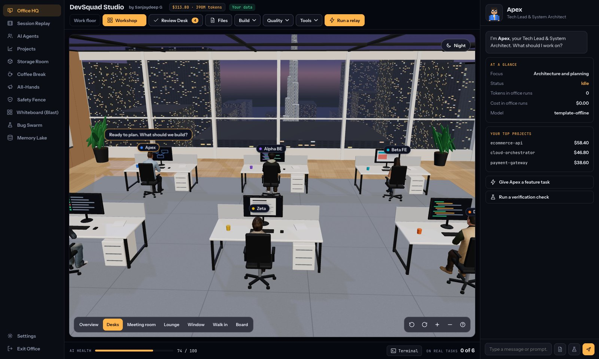
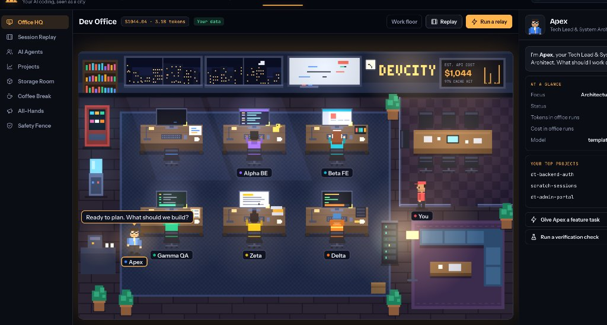

# 🛡️ DevSquad · Autonomous AI Engineering Studio

[](LICENSE)
[](https://www.python.org/downloads/)
[](https://github.com/sanjaydep1996/devsquad/actions/workflows/ci.yml)
[](https://sanjaydep1996.github.io/devsquad/)

> **A local-first, zero-bloat autonomous engineering studio that gives solo developers an on-demand virtual team (Architect, Coder, QA, DevOps) to build, test, and branch features on real-world codebases.**

**[▶ Open Live Interactive Demo](https://sanjaydep1996.github.io/devsquad/)** *(runs 100% in-browser with live animated agents, Review Desk, and Whiteboard)*

<p align="center">
  
</p>

---

## 💥 The Problem DevSquad Solves

Current AI coding tools fall into two frustrating extremes:

1. **The "Toy Project" Trap (ChatDev, MetaGPT)**: Multi-agent frameworks that simulate an entire software company, but only build trivial 200-line Python games in empty folders. They cannot read your existing 50,000-line repo, understand your database schema, or run your existing test suite.
2. **The "Destructive Overwriter" (Early Devin, OpenHands)**: Monolithic black boxes running in heavy Docker containers that directly modify your working tree without isolation, frequently introducing subtle bugs, breaking builds, and clobbering uncommitted work.

### 🌟 The DevSquad Difference
- **Operates on Your Real Repo**: DevSquad reads your existing project files, respects `.gitignore`, `CLAUDE.md`, `.cursorrules`, and detects your local test runners (`pytest`, `npm test`, `cargo test`, `go test`).
- **Zero Runtime Dependencies**: Written entirely using Python's standard library. Zero heavy Docker daemons, zero npm build steps. Boots in 1 second.
- **The "Review Desk" (Human-in-the-Loop)**: Agents **never** directly overwrite your files. All work is quarantined in a Staging Deck as clean unified diffs. You inspect the visual diff, verify real test results, and apply or rollback with a single click.
- **Interactive Whiteboard & Blast-Radius AST Analyzer**: Maps file modifications to callers, consumers, and test coverage before anything touches your branch.
- **Closed-Loop Auto-Healing**: When Gamma QA detects a failing test, it passes the failure stack trace back to Alpha to auto-heal the code before presenting the solution to you.
- **Ephemeral Git Worktree Isolation**: Background branch worktrees (`.devsquad/worktrees/<task-id>`) sandbox every run, keeping your active branch pristine.
- **100% Local & Private**: Runs on local Ollama models (`qwen2.5-coder`, `deepseek-coder`) with zero data leaving your machine.

---

## 🏢 Interactive Virtual Office & Features

<p align="center">
  
</p>

DevSquad combines high-fidelity terminal execution with a retro **2D Pixel Office** canvas running at 60 FPS:

### 1. 🔍 Interactive Blast-Radius Visualizer (On the Office Whiteboard)
Click directly on the **Whiteboard** on the office back wall or click **Blast Radius** in the topbar to inspect AST dependencies:
- **Direct Modifications (Amber)**: Code units being added or edited.
- **Caller / Consumer Risks (Red)**: Existing files and functions in the repo that import or call the modified components.
- **Active Test Coverage (Green)**: Verified test suites guarding the callers.
- **Overall Risk Rating**: Automatically calculates `LOW`, `MEDIUM`, or `HIGH` blast-radius risk.

### 2. 🌿 Ephemeral Git Worktree Isolation
- Agents branch off `HEAD` into `.devsquad/worktrees/<task-id>` without touching unstaged working edits.
- Allows running multiple autonomous relays simultaneously without branch interference.

### 3. 🐛 Issue-to-Repro Bug Swarm
Paste a GitHub Issue, Sentry error log, or raw stack trace:
1. **Apex Lead**: Triages the error and builds a root-cause spec.
2. **Gamma QA**: Auto-generates a minimal reproduction test (`tests/test_repro.py`) proving the failure (RED).
3. **Alpha Coder**: Crafts the targeted patch.
4. **Closed-Loop Verification**: Re-runs the test until GREEN with zero regressions.

### 4. 🧠 Multi-Tool Memory Lake
- Unifies sessions, rules, and conventions across **Claude Code** (`CLAUDE.md`), **Cursor** (`.cursorrules`), and **Aider** into `.devsquad/memory.json`.
- Injects past pitfalls and rules into agent prompts so past mistakes are never repeated.

### 5. ⚔️ The Merge Conflict Arena ("The Negotiation Table")
Click the **Glass Conference Room** in the office or **Merge Arena** in the topbar:
- **Semantic 3-Way AST Merge**: Detects when parallel agent worktrees diverge on imports, function signatures, or method bodies.
- **Autonomous Agent Negotiation**: Apex, Alpha, and Beta hold an automated negotiation meeting to harmonize interfaces without breaking callers.
- **AST Syntax Verification**: Verifies the synthesized merge with Python's AST parser ensuring `0 SyntaxErrors` before committing.

### 6. 📺 Retro CRT Terminal Sidecar (xterm.js & WebSockets)
Click any **Agent Desk** (Apex, Alpha BE, Beta FE, Gamma QA, Delta, Zeta):
- Authentic amber/green phosphor CRT terminal powered by **xterm.js**.
- Real-time bidirectional streaming over WebSockets (`ws://localhost:8080/ws/terminal/{agent_id}`).
- Interactive execution: run `pytest`, `git status`, `devsquad blast`, `devsquad heal`, or type arbitrary commands directly into the agent's sandboxed environment.

### 7. 🚨 Chaos Lab & Self-Healing CI (Server Rack Outage Simulator)
Click the **Industrial Server Rack** on the work floor:
- Injects simulated production/staging outages: `FLAKY_ENDPOINT`, `LATENCY_SPIKE`, `CIRCUIT_BREAKER_TRIP`, `SCHEMA_DRIFT`, `DB_LOCK_CONTENTION`.
- **Closed-Loop Healing Swarm**: Gamma QA and Alpha BE diagnose the failure, auto-synthesize resilience patterns (exponential backoff with jitter, circuit breakers, schema adapters), and generate regression tests.

### 8. 🛡️ Cyber Bunker & Security Vault (Zeta's Pentest Hub)
Click **Vault** in the topbar:
- Audits repo files and staged PRs for **Secret Leaks** (Anthropic, OpenAI, GitHub, AWS keys), **unsafe DOM sinks** (`innerHTML`, `eval`), **Command Injections**, and **OWASP Top 10** risks.
- Provides a real-time **Security Score (0-100)** and instant automated remediation diffs.

### 9. 🔀 Hybrid Model Router (Offline Ollama/vLLM + Cloud)
Click **Local AI** in the topbar:
- Route routine coding, linting, and tests to **100% free, private offline models** (Qwen 2.5 Coder, DeepSeek-Coder, Llama 3) via local Ollama/vLLM daemons.
- Live **Dollar Savings Tracker** estimating costs saved compared to cloud frontier APIs.

### 10. 🖨️ Engineering Artifacts Engine & Living ADR Publisher
Click **ADRs** in the topbar:
- **Autonomous Architecture Decision Records**: Zeta and Apex generate standardized ADRs (`docs/adr/`) documenting architectural decisions, context, and consequences.
- **OpenAPI 3.0 AST Extractor**: Auto-extracts OpenAPI/Swagger schemas directly from endpoint decorators and docstrings.
- **Automated Changelog Engine**: Formats conventional commits into styled markdown release notes.

### 11. 🔌 Multi-Agent MCP Desk Hub (Model Context Protocol)
Click **MCP Hub** in the topbar:
- Model Context Protocol (MCP) JSON-RPC 2.0 tool router for individual agent desks.
- Assign specialized tools (`run_test_suite`, `ast_blast_radius`, `flaky_stress_runner`, `security_audit`) to specific personas or connect external CLI tools.

### 12. 🎯 Spec-to-Code Roadmap Projector (PRD to DAG)
Click **Roadmap** in the topbar:
- Ingests raw Product Requirement Documents (PRDs) or feature stories.
- Decomposes specifications into an interactive **Directed Acyclic Graph (DAG)** with token budgets and topological task dispatch across Alpha, Beta, Delta, and Gamma.

### 13. 👻 Flaky Test & Race Condition Isolation Chamber
Click **Flaky Tests** in the topbar:
- Runs your real test command 5 to 50 times in the project, each run with a different `PYTHONHASHSEED`, and shows which runs passed and failed.
- Tells a flaky test (sometimes fails) apart from a broken one (always fails), shows the failing output, and gives the command to replay the first failure.
- Suggests a likely cause only when the output has a clear clue, such as a timeout or a refused connection.

### 14. 📸 Visual QA & Accessibility Auditor (WCAG 2.1 AA)
Click **Visual QA** in the topbar:
- Scans frontend viewports for WCAG 2.1 AA tap target sizing (<44x44px), horizontal mobile layout overflow risks (375px), missing accessibility labels, and Cumulative Layout Shift (CLS).

### 15. 📋 The Review Desk
- Quarantined staging deck managing all proposed changes.
- View test pass/fail banners, execution time, and syntax-colored unified diffs.
- 1-click **Apply to Workspace** (with `.devsquad.bak` backups) and **Rollback**.

---

## 👥 The Squad

DevSquad breaks engineering work across four specialized personas:

```
┌──────────────┐     ┌──────────────┐     ┌──────────────┐     ┌──────────────┐
│  📐 APEX     │ ──▶ │  💻 ALPHA    │ ──▶ │  🧪 GAMMA    │ ──▶ │  🌿 DELTA    │
│  Lead        │     │  Senior      │     │  QA & Test   │     │  DevOps &    │
│  Architect   │     │  Engineer    │     │  Specialist  │     │  Release     │
│              │     │              │     │              │     │              │
│  Drafts spec │     │  Implements  │     │  Runs local  │     │  Prepares    │
│  & contracts │     │  clean code  │     │  test suite  │     │  git branch  │
└──────────────┘     └──────┬───────┘     └──────┬───────┘     └──────────────┘
                            ▲                    │
                            └──── Auto-Healer ───┘
                                  (On Test Fail)
```

1. **Apex (Lead Architect)**: Reads the repository structure, conventions, and rules. Decomposes your goal into a clean specification (`spec.md`) and contract definition.
2. **Alpha (Senior Engineer)**: Implements modular, production-ready code fulfilling Apex's spec while adhering to your codebase style.
3. **Gamma (QA Specialist)**: Writes comprehensive test suites and **executes your local test runner in a background subprocess**. If tests fail, Gamma guides Alpha through an iterative auto-healing loop.
4. **Delta (DevOps Engineer)**: Generates a dedicated git branch name (e.g. `feat/jwt-refresh-rotation`) and formats conventional commit messages.

---

## 🚀 Quickstart

DevSquad requires **Python 3.10+** and zero external packages.

```bash
# 1. Clone DevSquad
git clone https://github.com/sanjaydep1996/devsquad.git
cd devsquad

# 2. Run in any repository you are working on
python3 -m devsquad.cli init

# 3. Launch the visual DevSquad Studio (Zero external dependencies)
python3 -m devsquad.cli up

# OR launch with FastAPI, Uvicorn & real-time WebSockets
pip install -e ".[server]"
devsquad up --fastapi
```

Open `http://localhost:8080` to access the **DevSquad Studio**:
- **Virtual Office Floor**: Watch Apex, Alpha, Beta, Gamma, Delta, and Zeta collaborate in real-time.
- **Retro CRT Terminal Sidecar**: Click any desk to open an authentic xterm.js terminal with live command streams.
- **The Negotiation Table**: Click the conference room for 3-way AST merge conflict resolution.
- **The Review Desk**: Inspect side-by-side diffs, view test execution logs, and click **"Apply to Codebase"** or **"Rollback"**.
- **Server Rack & Chaos Lab**: Simulate staging outages and test auto-healing swarms.
- **Interactive Whiteboard**: Click the back wall whiteboard to inspect real-time AST blast radius.

---

## 🕹️ CLI Usage

Prefer working directly in the terminal? DevSquad provides clean, intuitive CLI commands:

```bash
# 1. Initialize DevSquad in your current repo
devsquad init

# 2. Dispatch an autonomous feature relay
devsquad task "Add rate limiting middleware with unit tests"

# 3. Inspect staged diffs and test results in the terminal
devsquad review

# 4. Apply the verified staged diffs to your live workspace
devsquad apply <task_id>

# 5. Rollback anytime if needed
devsquad rollback <task_id>
```

---

## 🚀 DevSquad Studio v0.4.0 Capabilities

### 1. 🌐 Local AI Discovery
- **Tool detection**: Reports which AI tools are installed on your computer (`claude`, `gemini`, `cursor`, `aider`, `ollama`) and which local Ollama models you have.
- **Free AI only**: Agents run on Ollama or another model server on your computer, or in template mode. Paid cloud APIs are not used, and API keys in your shell are ignored.
- **Workspace context**: Reads `CLAUDE.md`, `.cursorrules` and `.aider.conf.yml` when present.

### 2. 🔮 Flight Recorder & Incident Blackbox (Interactive RCA & Time Machine)
- **Session ledger**: Every relay stage (plan, code, tests, healing, staging) is recorded to an append-only JSONL file in `.devsquad/flight_recorder/`.
- **Time Machine Scrubber**: Step backward or forward through a run to see what each agent did and which files changed.
- **Factual post-mortems**: A failed run gets a report built only from what was recorded: what failed, where, the last change before it, and the timeline. It says plainly when the root cause isn't known.

### 3. 🧬 Autonomous Git Bisect & Regression Teleporter
- **Real binary search**: Runs your own test command on past commits, in a scratch git worktree, to find the first commit where it fails. Each commit has a time limit.
- **Never touches your work**: Your branch, working tree and uncommitted changes stay as they are, and the scratch worktree is removed afterwards.
- **Honest results**: If the newest commit passes it says there's no regression; if the oldest commit checked also fails it says the bug is older. It suggests a revert only for a confirmed culprit, and asks you to check the diff first.

---

## 🧰 DevSquad Studio v0.5.0: the Workshop

Click **Workshop** in the topbar. Everything below works in template mode and gets smarter with a local Ollama model. Nothing uses paid AI.

### 1. 📋 Task board, with GitHub Issues sync
- Four columns: **Backlog**, **In progress**, **Review Desk** and **Merged**. Each card is a Markdown file in `.devsquad/tasks/`, so the board lives in git next to the code.
- **Assign to squad** runs the agents on a card. It moves to In progress, then to the Review Desk with its run attached. If the run fails, the card goes back to the Backlog with the reason.
- **Sync GitHub issues** adds open issues as cards using the `gh` CLI. It only reads issues; it never closes or edits them.

### 2. 🗺️ Plan, then build
- Describe a feature. Apex proposes tasks with owners, risks and questions you should answer first. With attached files, Apex reads them.
- Edit, remove or add tasks, then approve. Approving only adds cards to the board; nothing is built until you assign a card.

### 3. 🏗️ New app from one sentence
- "Build me an inventory app with login" becomes a FastAPI + SQLite app with sign-up, login (salted PBKDF2), per-user records, a responsive page, six passing tests, a README and a first ADR.
- The model only decides what the app stores (name, record, fields). The code comes from tested templates, so the app runs and its tests pass every time.
- Apps are staged in `.devsquad/greenfield/` and copied only into a new or empty folder you choose.

### 4. 🚢 DevOps desk
- Delta reads the project (dependencies, framework, start command, test runner, port) and every `os.getenv`, `os.environ`, and `process.env` it uses.
- Drafts a multi-stage non-root `Dockerfile`, `.dockerignore`, `docker-compose.yml`, GitHub Actions CI, Cloud Run and Kubernetes manifests, and `.env.example`, where secrets are left blank and each variable lists the files that use it.
- Preview each file, tick the ones you want, and add them. Existing files are kept unless you choose to replace them.

### 5. ✅ Setup
- Checks for Ollama, the recommended coding model (`qwen2.5-coder:7b`), an optional vision model, git and pytest, and says the next step for each gap. Models can be downloaded from the panel.

### 6. 📄 Agents read PDFs and images
- The text inside PDFs is extracted (standard library only) and given to the agents. Scanned PDFs are pictures of text and can't be read yet.
- Images and mockups are described by a local vision model such as `llava` when one is installed.

---

## 🧪 Testing & Verification

DevSquad includes full unit test coverage across repo scanning, diff computation, task staging, AST blast-radius analysis, git worktree isolation, bug swarm, multi-agent relay orchestration, flight recording, and autonomous git bisect:

```bash
python3 -m unittest discover tests -v
```

---

## 🏛️ Architecture & Principles

- **[ADR 0001: Autonomous Relay Architecture & The Review Desk](docs/adr/0001-autonomous-relay-and-staging-desk.md)**
- **Free AI only**: Agents use Ollama or another model server on your computer, or template mode. No paid cloud APIs, and no API keys needed.
- **Zero Hallucinated Clobbering**: No agent writes directly to your git working tree without staged approval.

---

## 📄 License & Attribution

DevSquad is open-source software licensed under the **[MIT License](LICENSE)**.

```text
MIT License

Copyright (c) 2026 Sanjaydeep Gowrishankar

Permission is hereby granted, free of charge, to any person obtaining a copy
of this software and associated documentation files (the "Software"), to deal
in the Software without restriction, including without limitation the rights
to use, copy, modify, merge, publish, distribute, sublicense, and/or sell
copies of the Software, and to permit persons to whom the Software is
furnished to do so, subject to the following conditions:

The above copyright notice and this permission notice shall be included in all
copies or substantial portions of the Software.

THE SOFTWARE IS PROVIDED "AS IS", WITHOUT WARRANTY OF ANY KIND, EXPRESS OR
IMPLIED, INCLUDING BUT NOT LIMITED TO THE WARRANTIES OF MERCHANTABILITY,
FITNESS FOR A PARTICULAR PURPOSE AND NONINFRINGEMENT. IN NO EVENT SHALL THE
AUTHORS OR COPYRIGHT HOLDERS BE LIABLE FOR ANY CLAIM, DAMAGES OR OTHER
LIABILITY, WHETHER IN AN ACTION OF CONTRACT, TORT OR OTHERWISE, ARISING FROM,
OUT OF OR IN CONNECTION WITH THE SOFTWARE OR THE USE OR OTHER DEALINGS IN THE
SOFTWARE.
```

Created and maintained with ❤️ by **[Sanjaydeep Gowrishankar](https://github.com/sanjaydep1996)**.
